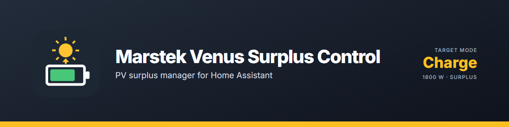
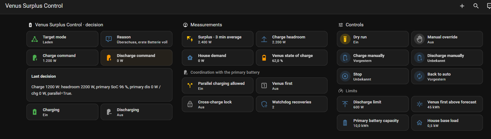

# Marstek Venus Surplus Control

[](LICENSE)
[](https://github.com/prusuino/ha_venus_surplus_control/releases)
[](https://github.com/prusuino/ha_venus_surplus_control/actions/workflows/validate.yml)
[](https://github.com/prusuino/ha_venus_surplus_control/actions/workflows/tests.yml)
[](https://www.home-assistant.io/)
[](https://developers.home-assistant.io/docs/core/integration-quality-scale/)
<a href="https://www.buymeacoffee.com/prusuino"></a>

A Home Assistant integration that runs a **Marstek Venus** battery from your PV surplus, next to an existing inverter-coupled battery or alone. No YAML: you pick your entities in the setup dialog, the controller does the rest.

## Highlights

- **Charge from real surplus only** – AC charging follows the surplus in 100 W steps, less a buffer you set, capped so that AC charge plus the Venus' own PV stay below the device limit. While your first battery (BYD, Pylontech, …) is still absorbing the surplus, the Venus waits. When the first battery stands at its own charge limit, the Venus takes what it leaves; the limit is recognised by itself, without a setting. On a good solar day ("Venus first") it may start early in parallel: when today's forecast is above a threshold you set, or when the remaining forecast or a projection of the current surplus shows that both will fill up.
- **Discharge against house demand only** – from 100 W up to your discharge limit, with hysteresis, a reserve and an export guard that follow the demand: in 50 W steps a step below the demand while a first battery covers the rest, in 10 W steps close to the demand when the Venus is the only source, so that a house drawing 200 W at night is served as well as one drawing 2 kW. With a first battery, only while it is already delivering, empty, or delivering nothing at all. "Empty" can follow the reserve you set on your inverter.
- **Standby otherwise** – and the two batteries do not charge each other: while the Venus charges, a first battery that starts to discharge a little lowers the charge command and a larger discharge stops the charge; while the Venus discharges, it stops as soon as the first battery charges.
- **RS485 watchdog** – the Venus firmware drops the RS485 control mode and resets its power registers on restarts, app or cloud access. The watchdog restores the control mode and the last command: every five minutes, and at once when the control mode drops, when the Venus comes back after a restart or a lost connection, or when the control mode is found off as the integration starts (switched off in the app in the meantime).
- **Discharge cap** – a ceiling you set from the dashboard that every command respects and that is enforced again when the app or a firmware reset raises the register.
- **Modbus self-heal** – reloads the Marstek Venus Modbus integration after a long connection loss.
- **Safe on bad data** – missing readings, a lost Modbus link or a surplus sensor that has fallen silent put the Venus into standby instead of letting it act on old values; a repair notice says which.
- **Dry run** – new entries start in dry run: the controller decides and writes every command it *would* send to the logbook, but touches nothing. Switch it off when the decisions look right.
- **Manual buttons** – charge, discharge, discharge down to a target SoC, stop and back to auto.
- **Diagnostics** – target mode, reason and the decision in words, every value behind it as attributes, a *Control quality* sensor that says when the Venus does less than commanded and why, a diagnostics download, and a logbook line for every command with its reasons.

This is the control logic that has run on my Venus A next to an inverter-coupled battery since summer 2026 as a YAML package, rebuilt as an integration so that it needs no YAML and no helpers.

## Requirements

- A Marstek Venus (A, C, D or E) reachable over Modbus TCP and the **[Marstek Venus Modbus](https://github.com/ViperRNMC/marstek_venus_modbus)** integration by ViperRNMC. This integration uses its *Force Mode* select (options standby / charge / discharge), the *Set charge power* and *Set discharge power* numbers, the *RS485 control mode* switch, SoC, AC power and inverter state. The Venus accepts one Modbus client; do not run a second tool against it.
- A power sensor giving **PV production minus house consumption** in W (surplus positive), or a grid meter (tick "import positive" in the setup).
- Optional: power, SoC and reserve (minimum SoC) of your first battery, a PV forecast for today and the remaining day in kWh (for example Solcast), the Venus' MPPT power sensors (A/D), its total capacity, the Modbus connection sensor.
- Home Assistant 2025.4 or newer.

## Installation

Through the **Marketplace** (Settings → Marketplace → Add from link → `prusuino/ha_venus_surplus_control`, category Integration) or HACS as a custom repository, then restart Home Assistant. Manual: copy `custom_components/venus_surplus` into your `custom_components` folder.

## Setup

Settings → Devices & services → Add integration → **Marstek Venus Surplus Control**.

1. **Required**: a name, your surplus sensor, and the seven Venus entities (Force Mode, two power numbers, RS485 switch, SoC, AC power, inverter state). The Venus entities are filled in from the Marstek Venus Modbus integration where they are found, whatever language or names they have; check them and change any that does not fit. Check the sign of the AC power sensor: positive must mean the Venus is *delivering* into the house; tick the invert box otherwise.
2. **Optional**: the Venus' MPPT sensors and capacity (suggested as well, together with the Modbus connection sensor and the Modbus config entry; MPPT inputs your model does not have are left out), your first battery's power (positive = discharging; tick invert if yours is the other way round) and SoC, its reserve if you change it now and then (a sensor, a number or a helper – see below), the forecasts, the Modbus connection sensor and the Modbus config entry (for the self-heal reload), and the device limits (AC charge 1200 W, total 1400 W, discharge 1000 W for a Venus A – raise them for a D or E) and the feed-in limit at the plug (see below).

Everything can be changed later under **Configure**.

### Without a first battery

The Venus can be your only storage. Leave **First battery: power**, **SoC** and **reserve** empty in the setup, and the controller works with the Venus alone:

- **Charging** starts as soon as the surplus minus the *Charging buffer* reaches *Charge from surplus of* (default 400 W). The Venus waits for nothing.
- **Discharging** follows the house demand whenever the house imports and the Venus is above its SoC protection.
- **Standby** otherwise.

The settings that refer to a first battery have no effect then: *Venus charges from first battery SoC*, *Charge in parallel from daily forecast*, *First battery capacity* and the cross-charging protection. The forecast sensors are not needed either. Everything else works the same: the charging buffer, the reaction, the device limits, the feed-in limit at the plug, the watchdog and the manual buttons.

If you add a battery to your inverter later, pick its two sensors under **Configure** and the coordination is on.

If you have a first battery but switch it off now and then, keep its sensors and tick **Carry on without the first battery when its readings are missing** under Configure: the Venus then works alone while the battery is off.

## Entities



| Entity | Meaning |
|---|---|
| `sensor.<name>_target_mode` | charge / discharge / standby / no data / paused, with the reason, the last command and the dry-run flag as attributes |
| `sensor.<name>_reason` | why: surplus with the first battery at its set SoC, parallel charging, first battery at its charge limit, house demand, own PV used directly, Venus SoC protection, first battery charges first, cross-charging trip, Venus is full, no condition, incomplete data, manual |
| `sensor.<name>_last_decision` | the decision in words; every value behind it (surplus, headroom, house demand, first battery, forecast, latches, counters) as attributes |
| `sensor.<name>_surplus_mean`, `…_surplus_without_venus_mean` | what the controller decides on |
| `sensor.<name>_charge_headroom`, `…_house_demand` | surplus minus the charging buffer; grid import corrected for the Venus |
| `sensor.<name>_charge_command`, `…_discharge_command` | the last commanded power |
| `sensor.<name>_watchdog_restores`, `…_dry_run_commands` | counters |
| `binary_sensor.<name>_charging`, `…_discharging`, `…_venus_first`, `…_parallel_charging_allowed`, `…_cross_charging_block`, `…_discharging_to_target_soc` | states for your automations |
| `switch.<name>_manual_override` | pauses the controller |
| `switch.<name>_dry_run` | decide and log only |
| number **Maximum discharge power** | ceiling for the discharge power; its maximum is the device limit or the feed-in limit |
| number **Minimum discharge power** | smallest discharge command. 0 (default) = automatic, which is 100 W. 100–500 W to set it yourself |
| `sensor.<name>_learned_night_load` | diagnostic: what the house typically draws at night, learned by the controller from the last seven nights |
| `sensor.<name>_control_quality` | diagnostic: *Stable*, *Changing mode often* (six or more changes between charging, discharging and standby within 30 minutes), *Venus does less than commanded* (under 70 % of a standing command for six ticks), with the reason where it is known while charging: *Cells cold* (below 20 °C), *Cells warm* (from 40 °C) or *Nearly full* (from 90 %) – in each of them the battery management of the Venus cuts the charge current, see [Why the Venus charges less than commanded](#why-the-venus-charges-less-than-commanded), *Venus does not respond* (nothing at all for six ticks), *Collecting data*, *Paused*. Attributes: the mode changes in the window, the share of the command the Venus follows, the cell temperatures if known, and what the controller has learned about the reporting of the surplus sensor. It changes no decision; in dry run only the mode changes are judged |
| number **Manual discharge target SoC** | where the button **Manual discharge to target SoC** stops (12–100 %, default 50). Only for that button: the automatic control always discharges down to 12 %, and it has nothing to do with charging |
| number **Parallel charging on forecast from surplus of** | surplus the remaining-forecast rule asks for before the Venus may charge in parallel (default 2500 W, 500–5000 W). Lower it for a small PV system |
| number **Charge from surplus of** | headroom (surplus minus the charging buffer) from which charging starts (default 400 W, 100–1500 W). Lower it to start on a small surplus |
| number **Charging buffer** | surplus the Venus leaves alone while charging (default 200 W, 0–500 W) |
| number **Export guard (Venus alone)** | how far the Venus stays below the house demand while it is the only source (default 10 W, 0–50 W) |
| select **Reaction** | how quickly the controller follows: *Calm*, *Normal* (default) or *Fast* – the surplus is averaged over 5, 3 or 1 minute, and the discharge power rises by up to 100 or 300 W per tick, or straight to the demand on *Fast*. Fast reacts sooner, but also to clouds and kettles |
| number **Venus charges from first battery SoC** | first battery SoC from which the Venus charges without the parallel rule (default 85 %). 0 = never wait for the first battery |
| number **Charge in parallel from daily forecast** | today's forecast (kWh) from which the Venus may charge in parallel early (default 45) |
| numbers **First battery capacity**, **Venus capacity (fallback)**, **House base load** | for the remaining-forecast rule |
| `button.<name>_manual_charge`, `…_manual_discharge`, `…_manual_discharge_to_target_soc`, `…_manual_stop`, `…_back_to_auto` | manual control |

The two numbers at the top and the buttons are under **Controls** on the device page, the others under **Configuration**. Entity IDs follow these names (`number.<name>_maximum_discharge_power`, `select.<name>_reaction`, …); entries set up before 0.7.0 keep the IDs they have (`…_discharge_cap`, `…_charge_reserve`, `…_target_soc`, `…_venus_first_from_forecast`, `sensor.…_surplus_3_min_mean`, `button.…_discharge_to_target_soc`).

Every command of the controller also fires the event `venus_surplus_command` with `command`, `power`, `reason` and `dry_run`; so does the standby at the end of a discharge to the target SoC (reason `target_soc_reached`).

## Dashboard card

The integration ships a Lovelace card, **Venus Surplus** (`custom:venus-surplus-card`), with a visual editor. It shows the state of charge as a gauge, charge and discharge power, the energy in the battery, the Venus' own PV if you picked the MPPT sensors, what the controller is doing and why, and a chart of the last hours. If you picked the Venus' MPPT sensors, its own PV appears by itself as soon as an input delivers: a tile with the total, one bar per MPPT input, a small panel on the Venus in the graphic and a line in the chart. An input that has delivered once stays and reads 0 W in the night; inputs with nothing connected stay hidden. If your setup has a first battery, it stands next to the Venus in the graphic and gets its own tile with SoC and power. The card only shows; the buttons stay on the device page.


The card file is served by the integration. Registering it as a Lovelace resource is a one-time step that is left to you, because the resource list is part of your dashboard configuration:

**Settings → Dashboards → ⋮ (top right) → Resources → + Add resource**

| Field | Value |
|---|---|
| URL | `/venus_surplus_files/venus-surplus-card.js` |
| Resource type | JavaScript module |

Then reload the page (Ctrl/Cmd+Shift+R). The card appears in the card picker as **Venus Surplus**. Point it at the **Target mode** sensor; it finds the Venus entities of your setup by itself.

```yaml
type: custom:venus-surplus-card
entity: sensor.venus_target_mode
```

| Option | Default | |
|---|---|---|
| `entity` | – | the *Target mode* sensor of the controller |
| `title` | device name | heading of the card |
| `first_battery_name` | – | name shown for the first battery, for example its brand |
| `hours` | `6` | hours the chart covers (1–48) |
| `show_illustration` | `true` | the graphic with panel, battery and house; it hides itself on narrow cards |
| `show_chart` | `true` | the chart of charge power, discharge power and state of charge |

The chart reads the history of your Venus' AC power and SoC sensors from the recorder; if you exclude them there, it stays empty.

## How it decides

Every 30 seconds (adjustable) the controller takes a sample of the surplus and of the surplus with the Venus' own AC flow taken out, keeps three minutes of samples and decides on their means:

1. **Protect** – Venus SoC ≤ 12 %: no discharging (it may still charge). First battery discharging > 500 W while the Venus charges (or charging while it discharges): standby ("cross trip").
2. **Charge** if the AC command would be ≥ 100 W and either the first battery is ≥ 85 % (80 % to hold) or the first battery takes nothing (neither charging nor discharging for six ticks with at least 400 W of headroom – in standby or limited, for example), or the first battery is at its charge limit (it charges at a steady power for six ticks while at least 400 W more surplus stands than it takes; the Venus then gets only that rest, and the rule ends once the first battery takes clearly more or less), or parallel charging is allowed: surplus ≥ 1200 W and headroom ≥ 500 W on an ordinary day (600 / 400 W when "Venus first"), the first battery not discharging more than 80 W and, on an ordinary day, not absorbing more than 200 W (500 W to hold). Next to a first battery that is still charging itself (more than 200 W), the charge power does not jump to the whole surplus: it starts with what the first battery leaves, at least 200 W, and rises by 200 W per tick, so that the first battery can give way. Charging is blocked while the first battery discharges more than 150 W (200 W to hold, confirmed over two ticks; 350 W immediately). Below that, a running charge is not stopped: the command is lowered by what the first battery discharges plus 50 W and comes back by 50 W per tick once it no longer does. The same holds for the grid: when a load switches on and more than 100 W are imported while the Venus charges, the command is lowered by that import plus 50 W in the same tick, without waiting for the average, and comes back by up to 100 W per tick; a charge does not start while the grid delivers either. Power: the headroom – surplus minus the charge reserve (200 W unless you change it) – floored to 100 W, start from 400 W, hold down to 80 W for three ticks, step up 150 W above the current target, step down only 120 W below it; minus the Venus' own PV against the total limit. With MPPT sensors, a reading that drops to zero while charging is bridged with the last known value; without a known value the power is not raised for four ticks, after that the reading is believed. A Venus that stands at 100 % and takes nothing for four ticks is full: it gets the standby command (reason *Venus is full*), also when it already stands by on its own, and is charged again once it is below 98 %.
3. **Discharge** if the house imports and the surplus mean is below 100 W, the Venus is above 15 % (12 % to hold), and the first battery is not charging more than 100 W. With a first battery, one of these must hold as well: it delivers ≥ 500 W, it has been delivering ≥ 150 W for 90 seconds (so that the Venus also helps in a house with a small base load, and a passing cloud does not start it), it is empty (≤ 12 %, or its reserve plus 3 points – see below), or it delivers nothing at all although the house has been importing for 90 seconds (paused, in standby, at a limit). **A large load takes a fast lane:** when the house needs 400 W or more and that much comes from the grid for two ticks in a row, the Venus starts at once – whatever the surplus mean still says and whatever the first battery does (unless it is charging). While the house needs that much, the mean does not stop the discharge either. Power: the house demand minus a reserve, 100–1000 W in 50 W steps, never above the export guard or the discharge cap. It climbs by up to 100 or 300 W per tick, or straight to the demand (see *Reaction*) and comes down in one step when the demand drops. Reserve and export guard follow the demand: the reserve is 20 % of it, at least 40 W and at most 120 W; the guard 10 %, at least 30 W and at most 60 W. A house that draws 220 W gets 150 W from the Venus, one that draws 900 W gets 750 W; the first battery, which follows the meter, covers the rest. **When the Venus is the only source** – no first battery, or one that is empty or at rest – nobody covers the rest, and every watt held back is imported. The Venus then follows the demand closely: 10 W steps, no reserve, and an export guard of 10 W that you can change (*Export guard (Venus alone)*). A house that draws 220 W gets 210 W, one that draws 900 W gets 890 W. The command stays where it is as long as it does not export. A discharge that runs at the minimum keeps going until the house needs 40 W less than that, so that a small base load with a fridge cycling on top does not switch the Venus on and off; in that band up to 40 W are exported.

"Venus first" is true when today's forecast is above the threshold, when the remaining forecast covers both batteries plus the house until sunset with 20 % margin and there is real surplus now (at least *Parallel charging on forecast from surplus of*, default 2500 W), or when a projection from the current surplus shows the first battery full long before sunset while the Venus would not make it (with a forecast set up, only if the remaining forecast less the house demand until sunset also covers what the first battery misses). The two latter latch until sunset.

Missing input values for two consecutive ticks put the Venus into standby.

### When the first battery counts as empty

An inverter stops discharging its battery at a reserve (minimum SoC). From there on the first battery delivers nothing, and the Venus must not wait for it. By default the Venus takes over once the first battery is at 12 % or below. If you raise that reserve now and then – in winter, or to keep backup power – pick the entity that holds it as **First battery: reserve** under Configure: a sensor or number of your inverter's integration, or a number helper you set yourself. The first battery then counts as empty at the reserve plus 3 points, never below 12 %. While the reading is unavailable the last value is kept. Without a first battery none of this applies.

## Which setting does what

The values to tune are on the device page under **Configuration**; **Configure** on the integration's entry holds the entities and the device limits.

| You want | Change |
|---|---|
| the Venus to start charging on a smaller surplus | lower **Charge from surplus of** (default 400 W) and the **Charging buffer** (default 200 W). Charging starts when the surplus minus the buffer reaches the first value |
| it to react faster | set **Reaction** to *Fast*, and shorten the decision interval under Configure (default 30 s). Large loads (400 W and more that nobody covers) are served within two ticks on every setting |
| the Venus to charge although the first battery is not full | lower **Venus charges from first battery SoC** (default 85 %); 0 means the Venus never waits |
| the Venus to charge in parallel on good days | lower **Charge in parallel from daily forecast** to a value your forecast reaches on such days |
| less discharge power | lower **Maximum discharge power**, or set a feed-in limit under Configure |
| the Venus to cover a small base load at night | nothing: it discharges from about 130 W of house demand, and next to a first battery it joins in once that one has been delivering 150 W or more for 90 seconds (at once from 500 W). **Minimum discharge power** raises the first value |
| to empty the Venus to a level by hand | **Manual discharge target SoC** and the button **Manual discharge to target SoC** – this pair does nothing else |

The sensor **Reason** says why the controller does what it does, **Last decision** shows the numbers behind it. Every setting is described in the next section: what it does, why it is there and when to change it.

## Settings in detail

There are two places. The **device page** (Settings → Devices & services → Marstek Venus Surplus Control → the device of your entry) holds everything you may want to change while it runs. **Configure** on the entry holds the entities and the limits of your hardware.

All power values are in watts. "Surplus" always means PV production minus house consumption, averaged (see *Reaction*), with the Venus' own flow taken out, so that the Venus charging does not eat the surplus it is measured by.

### Device page: Controls

**Maximum discharge power** – 200 W up to your discharge limit, in 100 W steps, default 1000 W.
- *What it does:* the most the Venus delivers into the house, in automatic and in manual operation. The controller never commands more.
- *Why it is there:* the Venus app and firmware resets write their own values into the Venus. The controller sets a higher value back, so the limit you chose holds. It is also the simple way to make the battery last longer.
- *When to change:* lower it if the Venus should last through the night or cover only the base load. The upper end of the field is the *Maximum discharge command* from Configure, or the feed-in limit if that is lower.

**Manual discharge target SoC** – 12–100 %, default 50 %.
- *What it does:* the level at which the button *Manual discharge to target SoC* stops. Nothing else.
- *Why it is there:* to bring the Venus to a level by hand, for example before plugging in an extension battery or to make room ahead of a very sunny day.
- *What it does not do:* the automatic control ignores it. It always discharges down to 12 % when the house needs it, and this value has no effect on charging.

**Manual override** (switch).
- *What it does:* on, the controller pauses and sends nothing; the Venus stays in whatever state you set by hand or with the buttons. Off, the controller takes over at the next decision.
- *Why it is there:* without it the controller would overwrite anything you do by hand at its next decision.

**Dry run** (switch) – on for new entries.
- *What it does:* the controller decides as usual and writes every command it would send to the logbook, but does not touch the Venus. The sensor *Dry-run commands* counts them.
- *Why it is there:* so that you can check for a few days that the entities and signs are right before the integration controls a battery. Switch it off when the decisions look right.

**Buttons.**
- *Manual charge:* charges at the maximum AC charge command until you stop it. It ignores the surplus, so it may draw from the grid.
- *Manual discharge:* discharges at the maximum discharge power until you stop it or the Venus is empty. It ignores the house demand, so it may export.
- *Manual discharge to target SoC:* the same, but it stops by itself at the *Manual discharge target SoC* and puts the Venus into standby. See [Discharge to a target SoC](#discharge-to-a-target-soc).
- *Manual stop:* standby, and it stays there.
- *Back to auto:* ends any manual state and hands control back.

The four manual buttons switch the manual override on; only *Back to auto* (or the switch) ends it. That is deliberate: otherwise the controller would undo your command at once.

### Device page: Configuration

**Parallel charging on forecast from surplus of** – 500–5000 W, default 2500 W. One of the ways to "Venus first": when the remaining forecast covers both batteries and the house until sunset, the Venus may charge in parallel, but only while there is this much real surplus right now. 2500 W suits a larger PV system; with a small one the value is rarely reached, so lower it.

**Charge from surplus of** – 100–1500 W, default 400 W.
- *What it does:* how much usable surplus there must be before the Venus starts charging. "Usable" is the surplus minus the charging buffer below; the sensor *Charge headroom* shows it. With the defaults charging starts at 400 W + 200 W = 600 W of surplus.
- *Why it is there:* a battery inverter works poorly at very low power, and starting on every small surplus means switching on and off all day. Once charging, the Venus follows the surplus down to 100 W and only stops when the headroom stays below 80 W for three decisions, so it does not flutter around the start value.
- *When to change:* lower it with a small PV system or if you want to use every bit. Raise it if the Venus starts and stops too often on cloudy days.

**Charging buffer** – 0–500 W, default 200 W.
- *What it does:* surplus the Venus deliberately leaves unused while charging. With 1000 W of surplus and a buffer of 200 W it charges at 800 W.
- *Why it is there:* the surplus changes faster than the controller can follow. A light, a TV or a thin cloud takes 100–200 W away within a second; without a buffer the Venus would draw exactly that from the grid until the next decisions have corrected the charge power.
- *When to change:* lower it (down to 0) to store more of your PV, and accept short moments of grid import. Raise it if you see the Venus charging from the grid now and then.

**Reaction** – Calm, Normal (default) or Fast.
- *What it does:* the controller decides on an average of the surplus, not on the value of the moment. *Calm* averages over 5 minutes, *Normal* over 3, *Fast* over 1. The same setting says how fast the discharge power climbs when the house suddenly needs more: by up to 100 W per tick on *Calm*, 300 W on *Normal*, and straight to the demand on *Fast*. From 300 to 1200 W that is four and a half minutes, a minute and a half or one tick at the default tick. Coming down is always immediate, so the Venus delivers too much for one tick at most, and a first battery that follows the meter takes that up.
- *Why it is there:* the surplus jumps with every kettle, coffee machine and cloud by one or two kilowatts for seconds. Following that directly would switch the Venus on and off constantly and gain nothing.
- *Example:* the sun comes out and the surplus jumps from 0 to 1000 W. With the default start at 600 W of surplus the Venus begins after about 2 minutes on *Normal*, after about 40 seconds on *Fast* and after about 3 minutes on *Calm*.
- *When to change:* *Fast* if the Venus should catch short sunny spells and you accept that it also reacts to short dips. *Calm* if it switches too often. How often the controller decides at all is the *Decision interval* under Configure.

**Minimum discharge power** – 0 = automatic (default, 100 W), or 100–500 W in 100 W steps.
- *What it does:* the smallest discharge command. Discharging starts once the house needs roughly this much plus the reserve, and a running discharge at this power stops when the house needs 40 W less than it.
- *Why it is there:* below the minimum the Venus stands by and the house imports. With 100 W, a house that draws 150 W at night is still served.
- *When to change:* normally not at all. Raise it if you want the Venus to work only for larger loads, or if you find yours inefficient at 100 W.

**Export guard (Venus alone)** – 0–50 W in 5 W steps, default 10 W.
- *What it does:* while the Venus is the only source – no first battery, or one that is empty or at rest – it delivers the house demand minus this value, rounded down to 10 W. What it holds back comes from the grid.
- *Why it is there:* the Venus is commanded on a reading that is a few seconds old. When a load switches off, it delivers too much until the next decision, and that goes into the grid. The guard keeps the steady state a little on the import side, so that small swings of the demand do not export.
- *Example:* the house draws 237 W. With 10 W the Venus delivers 220 W and 17 W are imported; with 0 W it delivers 230 W and 7 W are imported.
- *When to change:* lower it, down to 0, if your meter shows more steady import at night than you like and a few watts of export now and then do not matter. Raise it if export costs you something or must not happen. Next to a first battery that delivers, the setting has no effect: there the reserve and the guard follow the demand, and the first battery covers the rest.

**Venus charges from first battery SoC** – 0–100 %, default 85 %. Only with a first battery.
- *What it does:* below this level of the first battery the Venus leaves the surplus to it. From this level on the Venus charges from whatever surplus is left. Once charging, it keeps going until the first battery is 5 points below the value.
- *Why it is there:* the first battery sits on the PV inverter and charges directly from the panels, without the detour over AC. The Venus charges over AC and loses about 10 % more on the way in and out. So the first battery should fill first, and the Venus takes what it cannot use. 85 % rather than 100 %, because batteries charge slowly near the top and surplus would be exported meanwhile.
- *Exceptions:* the Venus charges earlier in two cases, see [How it decides](#how-it-decides): parallel charging on days with plenty of sun, and a first battery that takes nothing (in standby, limited or faulty).
- *When to change:* set it to 0 if the Venus should never wait for the first battery, for example because something else manages that battery. Lower it if surplus goes to the grid while the first battery slowly fills its last percent.

**Charge in parallel from daily forecast** – 0–200 kWh, default 45 kWh. Only with a forecast sensor.
- *What it does:* if today's PV forecast is at least this high, the Venus may charge next to the first battery from the morning on ("Venus first") instead of waiting for it.
- *Why it is there:* the Venus charges at about 1 kW. On a good day the first battery is full by noon, and the hours left are not enough to fill the Venus as well; the rest of the surplus is exported. Starting both in the morning uses those hours. On a poor day the same would leave the first battery half empty, so it only applies above a forecast you choose.
- *When to change:* set it to what your forecast shows on a clearly sunny day: roughly a day of house consumption plus both batteries. Too low, and on a mediocre day the first battery may not get full; too high, and on a good day the Venus starts late.

**First battery capacity** – 0–100 kWh, default 10 kWh. **Venus capacity (fallback)** – 0–50 kWh, default 5.12 kWh. **House base load** – 0–5000 W, default 500 W.
- *What they do:* they feed a second way to "Venus first". During the day the controller compares the remaining forecast with what is still needed until sunset: what both batteries lack, plus the base load times the hours of sun left, plus 20 %. If the forecast covers it and there is real surplus right now, the Venus may charge in parallel.
- *Why they are there:* the daily forecast alone decides in the morning. This check corrects during the day: a day that started cloudy and clears up can still fill both batteries, and the controller needs to know how much "both batteries" and "the house" are.
- *What to enter:* the usable capacity of your first battery, and what your house draws on average during the day. The Venus capacity is only used when you have not picked the capacity sensor under Configure (5.12 kWh is one Venus; with an extension battery enter the total). Without a remaining-forecast sensor these three have no effect.

### Configure: entities

**Surplus sensor** – PV production minus house consumption in W, positive while there is surplus. It is the one value everything is decided on. If you only have a grid meter that is positive while importing, pick it and tick *The surplus sensor is a grid meter with import positive*. A meter shows only what is left after your first battery, so with a first battery set up the controller takes that battery's own flow out of the meter value by itself: it then sees the house demand also while the first battery covers it, and the full surplus also while the first battery absorbs it. No helper is needed for that. The value must include the Venus (as a meter at the grid connection does); the controller takes the Venus' own flow out itself.

**The seven Venus entities** – all from the Marstek Venus Modbus integration: Force Mode (select), Set charge power and Set discharge power (numbers), RS485 control mode (switch), battery SoC, AC power and inverter state (sensors). The first four are what the controller writes, the other three tell it what the Venus is really doing. AC power must be positive while the Venus delivers into the house; tick the invert box if yours is the other way round.

**Venus: MPPT power sensors** – only for a Venus with its own PV inputs (A, D). The Venus then charges from two sides, and the controller keeps AC charging plus own PV below the total limit. Leave empty for a C or E.

**Venus: total battery capacity** – the capacity sensor of the Modbus integration. It follows an extension battery by itself. Without it the fallback number is used.

**First battery: power and SoC** – of the battery on your PV inverter, if you have one. Power positive while discharging (invert box otherwise). They are what keeps the two batteries from charging each other. Without them the Venus is the only storage: it charges from any surplus and discharges against any import, and all first-battery rules are off.

**Carry on without the first battery when its readings are missing** – off by default. While the power or SoC of the first battery is unavailable, the controller has no complete picture: it sends no commands and puts the Venus into standby. That is right for a short outage, but not for a first battery you switch off for a while, because the Venus would stand by for as long as it is off. With this option on, the controller waits 5 minutes and then runs the Venus alone, as if no first battery were set up; a repair notice says so. As soon as the readings return, the first battery counts again. Leave it off if your surplus sensor is a grid meter and the battery may keep working while its sensors are gone (an integration that drops out, for example): the Venus could then discharge into it.

**First battery: reserve** – the minimum SoC at which your inverter stops discharging it, as a sensor, number or helper. See [When the first battery counts as empty](#when-the-first-battery-counts-as-empty). Leave empty if you never change it or if your battery may go down to 0 %.

**PV forecast for today / remaining today** – in kWh, for example from Solcast or Forecast.Solar. Both optional. Without them the first battery always goes first, apart from the two exceptions above.

**Dampening of the remaining forecast** – 0.3–1.2, default 0.8. The remaining forecast is multiplied by this before it is compared with the need. Forecasts tend to be optimistic, and being wrong means a half-empty first battery in the evening; 0.8 takes 20 % off.

**Venus: Modbus connection** and **Marstek Venus Modbus config entry** – for the self-heal. The Modbus connection to the Venus sometimes hangs until the integration is reloaded; if the connection sensor reports a loss for more than five minutes, the controller reloads that config entry.

### Configure: limits

**Maximum AC charge command** – 100–3600 W, default 1200 W. The highest charge power the controller sends: what your Venus and the circuit it is plugged into allow. Most models take 2500 W or less; check the data sheet of yours before you raise it. A Venus A takes about 1000 W from the grid whatever the command says, so 1000 W is the right value for it (see [Why the Venus charges less than commanded](#why-the-venus-charges-less-than-commanded)).

Both this limit and *Maximum discharge command* also stop at the maximum of the number entity the command is written to: Home Assistant refuses a value above it, and the command would never reach the Venus. The Venus has limits of its own as well: the maximum charge and discharge power set in the Marstek app (800 W or the full power of the model), and what its battery management allows at the moment (see [Why the Venus charges less than commanded](#why-the-venus-charges-less-than-commanded)). A command above them is accepted and cut by the device, and *Control quality* then shows *Venus does less than commanded*.

**Maximum AC charge + own PV** – default 1400 W. With own PV the Venus charges from two sides and has an upper limit for both together (check the data sheet of your model); the controller lowers the AC command so that the sum stays below this. Without own PV set it to the same value as the AC charge command.

**Maximum discharge command** – 200–3600 W, default 1000 W. What your Venus can deliver and what you are allowed to feed in at the plug; most models deliver 2500 W or less. For a Venus A the manufacturer gives 1200 W (the app offers 800 W or 1200 W); mine delivered 983 W at a 1000 W command, 1185 W at 1200 W and 1382 W at 1500 W, the last one above the rated power. It is the upper end of *Maximum discharge power* on the device page.

**Feed-in limit at the plug** – None, 600 W, 800 W or your own value. See [Feed-in limit at the plug](#feed-in-limit-at-the-plug).

**Decision interval** – 15–120 s, default 30 s. How often the controller samples and decides. Shorter reacts faster and writes more often to the Venus; I would not go below 30 s without a reason.

### What is fixed

Some values are part of the control behaviour and not adjustable, because changing them makes the Venus hunt back and forth: charging moves in 100 W steps, discharging in 50 W steps, or 10 W steps when the Venus is the only source (how far it climbs per tick follows *Reaction*); the charge power goes up when the headroom is 150 W above the current target and down when it is 120 W below; discharging leaves a reserve of 20 % of the house demand to the grid (40 to 120 W) and steps down before the house would export; the Venus does not discharge below 12 % and resumes at 15 %.

## Feed-in limit at the plug

Many countries limit what a plug-in device may deliver into the house wiring: 600 W is common in Switzerland, 800 W in Germany and Austria. Under **Configure** you pick *None*, *600 W*, *800 W* or your own value. Check the rules that apply to your installation; the integration does not decide that for you.

The limit applies to discharging only; charging from the grid is not limited.

- The discharge command, the number *Maximum discharge power* (its maximum follows) and the manual discharge buttons never go above it.
- The discharge command is what the Venus delivers at the plug. On a Venus with its own PV (A, D) the PV goes into the battery and does not come on top: my Venus A delivered 983 W at a 1000 W command while its MPPTs produced about 500 W.
- As a safeguard, the controller compares the measured AC power with the command while discharging. Should the Venus deliver more, it steps the command down by the difference. Differences under 40 W are taken as measurement noise.
- The command never goes below the minimum discharge power because of the limit. Standing by instead would only send the PV into the Venus' own battery while the house draws from the grid. If the measured AC power is still above the limit, the diagnostic value `feed_in_exceeded` is true.
- The manual buttons and *Manual discharge to target SoC* cap the command, but do not subtract the PV.

The diagnostics show `feed_in_limit_w`, `discharge_feed_in_cap_w`, `feed_in_extra_w` and `feed_in_exceeded`.

## Discharge to a target SoC

Set the number **Manual discharge target SoC** and press **Manual discharge to target SoC**. The manual override switches on and the Venus discharges at the discharge cap until its SoC is at or below the target, then it goes to standby. The target starts at 12 % because the Venus does not discharge below that; if you have raised the discharge cut-off on the Venus itself, keep the target above it, or the run never reaches its end. This run ignores the house demand, so the Venus may export to the grid. The override stays on at the end – otherwise the controller would simply go on discharging against the house demand – so press **Back to auto** when you are done. Any other manual button, or switching the override off, cancels the run; `binary_sensor.<name>_discharging_to_target_soc` is on while it lasts. A Venus with its own PV (A/D) keeps charging from its MPPTs, which cannot be switched off from here: by day the net discharge is the command minus that production, and after the stop the SoC rises again.

## Why the Venus charges less than commanded

The charge command is an upper limit. How much the battery takes is decided by its own battery management, which cuts the charge current by cell temperature and state of charge. For the Venus A and D the firmware allows the full current only between 20 and 40 °C; between 15 and 20 °C it is about 80 %, between 10 and 15 °C half, between 5 and 10 °C 40 %, and less below. From 90 % state of charge the current is halved even at normal temperature, from 95 % it is a fifth, and at 100 % it is zero. A Venus in an unheated room that takes 800–900 W at a 1200 W command on a winter morning is therefore working as designed, and takes more once the cells have warmed up. (The figures are from the [firmware analysis by sphings79](https://github.com/sphings79/Marstek-Venus-Firmware-Reverse-Engineering); they matched what a Venus A did at 10 °C.)

The controller needs nothing for this: it decides on the power the Venus really takes, not on the command. *Control quality* names the reason. For *Cells cold* and *Cells warm* it reads the cell temperatures of the Marstek Venus Modbus integration by itself; those two sensors (*Min cell temperature*, *Max cell temperature*) are disabled there by default, so enable them if you want the reason shown. The temperature the same integration shows as *Internal temperature* is the heat sink of the inverter, which warms up within minutes while the cells stay cold.

There is a limit of the model as well. My Venus A takes about 1010 W at the plug at any charge command from 1000 to 1400 W, and just the same in the manual mode of the Marstek app set to 1500 W; in six months it never took more, in summer or in winter. Its own PV comes on top of that inside the battery. A command above what the model takes does no harm, but below 70 % of the command *Control quality* shows *Venus does less than commanded* for good, so set *Maximum AC charge command* to what your model really takes.

## Dry run and first days

Leave **dry run** on for a day or two. The logbook (filter "Venus Surplus") shows every command with its reasons; `sensor.<name>_last_decision` shows the values. When the decisions match what you expect, switch dry run off. The controller then writes its standing decision to the Venus right away.

## Diagnostics and debug log

Two ways to see what the controller does, both on the integration's page under Settings → Devices & services:

- **Download diagnostics** (⋮ on the entry): a snapshot with the chosen entities and limits, the settings, the last decision with every value behind it, and the current reading of each entity.
- **Enable debug logging**: while it is on, the controller writes one line per tick with what it read, what it decided and why (surplus, headroom, house demand, SoC and power of both batteries, the command, the flags). Let it run through the situation you want to look at, then switch it off; Home Assistant offers the log as a download. The lines hold numbers and flags only, no entity names. Without debug logging nothing of this is written.

For a bug report, the debug log of ten minutes around the problem says more than a screenshot.

## Repairs

Three notices can appear under **Settings → Repairs**; each disappears by itself when its cause is gone.

- **Readings incomplete** – no complete readings for about five minutes (an entity of the Venus or the surplus sensor missing or unavailable, or, with a connection sensor set up, the Modbus connection to the Venus down: the Modbus integration keeps the last values of its sensors then, and the controller does not use them). The notice names the entities concerned.
- **Surplus sensor is silent** – the surplus sensor has a value but has not reported for far longer than it ever has. A value that old is not used: the controller sends no commands and puts the Venus into standby, so that a reading frozen at a large surplus or a large demand cannot keep it charging from the grid or exporting. The next report of the sensor, even of the same value, ends it. How long is too long is learned per sensor, because sensors differ: one reports every few seconds, another only when its value changes and is then silent for as long as the house draws the same. The controller measures the gaps between the reports, for the first 24 hours without judging anything, and after that counts the sensor as silent at three times the longest gap of the last seven days, never before 10 minutes. The attributes `surplus_longest_gap_seconds` and `surplus_silence_limit_minutes` of *Control quality* show what it has learned.
- **The Venus does not respond** – a charge or discharge command has stood for 10 minutes and the Venus does nothing. The controller keeps the command; check the device, the limits set in the Marstek app and the RS485 control mode. Not raised in dry run.

If the Venus drops off Modbus at regular intervals, look at its firmware first: EMS firmware 150 has been reported to stop answering about every half hour, and a later version to end that.

**Short pauses are the Venus, not the controller.** A Venus A goes to standby by itself every now and then while a command stands, and carries on a moment later: for about a minute while discharging, for about 20 seconds while charging, a quarter to half an hour apart (measured on firmware V151, over several days and with two different controllers; the length of the pause did not depend on who was controlling). Near a full battery the pauses come more often. The control mode stays on and nothing is lost: the controller sends the command again at its next tick, and the first battery or the grid covers the gap. In a chart this shows as the Venus dropping to 0 W for a moment; *Control quality* stays *Stable*, because one pause is not six ticks without an answer.

## Removal

1. Switch **dry run** on or put the Venus into standby yourself first if a command is running: the integration sends no final command when it is removed.
2. **Settings → Devices & services → Marstek Venus Surplus Control**, open the entry's menu (⋮) and choose **Delete**. The entities, their history, the device and the persisted controller state go with the entry.
3. Remove the integration itself in the **Marketplace** (or HACS; it was added from a link), then restart Home Assistant. With a manual installation, delete `custom_components/venus_surplus` instead. The Marstek Venus Modbus integration is not affected.

## Quality scale

The integration declares **Silver** on the [Home Assistant integration quality scale](https://developers.home-assistant.io/docs/core/integration-quality-scale/). Bronze: a config flow with tests, unique ids for every entity, brand images, installation and removal instructions, a check of the chosen entities before the controller starts, no duplicate entries, runtime data on the config entry. Silver on top of it: the entities turn unavailable when the Venus cannot be read and that is logged once, entries unload cleanly, every setup and Configure parameter is documented, parallel updates are declared, and the tests cover more than 95 % of the code (the test workflow fails below that). The tier is self-assessed, as it is for every custom integration; the per-rule status, including what is still open for Gold, is in `custom_components/venus_surplus/quality_scale.yaml`.

## Disclaimer

Provided **as-is, without any warranty**. The integration writes charge and discharge commands to a battery. Wrong sensors, signs or thresholds can cost energy or battery life. Keep the manual override within reach. Not affiliated with Marstek; all product names belong to their owners.

## License

MIT – see [LICENSE](LICENSE).

## Related projects

More of my Home Assistant projects:

- [Swiss Meteo](https://github.com/prusuino/ha_swiss_meteo) — MeteoSwiss open data: local forecast, live station values, official warnings, pollen, radar, station history and dashboard cards
- [Swiss Solar Reference Price](https://github.com/prusuino/ha_swiss_solar_reference_price) — Swiss solar feed-in reference market price
- [Swiss Electricity Price](https://github.com/prusuino/ha_swiss_electricity_price) — official ElCom electricity tariffs for your municipality
- [Swiss Public Alerts](https://github.com/prusuino/ha_swiss_public_alerts) — official Alertswiss warnings for your location
- [Swiss Earthquakes](https://github.com/prusuino/ha_swiss_earthquakes) — recent earthquakes from the Swiss Seismological Service on a map
- [Swiss Avalanche Bulletin](https://github.com/prusuino/ha_swiss_avalanche_bulletin) — SLF avalanche danger for your region
- [Swiss Waters](https://github.com/prusuino/ha_swiss_waters) — live water temperature, water level, discharge and flood danger of Swiss rivers and lakes
- [Swiss Hail Protection](https://github.com/prusuino/ha_swiss_hail_protection) — Swiss hail warnings for your blinds: the official VKF hail-protection signal or the MeteoSwiss hail radar around your location
- [Swiss Solar Forecast](https://github.com/prusuino/ha_swiss_solar_forecast) — PV production forecast from the MeteoSwiss local forecast and the Sonnendach solar cadastre
- [Swiss Charging Stations](https://github.com/prusuino/ha_swiss_charging_stations) — real-time availability and prices of public EV charging stations in Switzerland
- [Austrian Charging Stations](https://github.com/prusuino/ha_austrian_charging_stations) — real-time availability of public EV charging stations in Austria
- [Swiss Public Transport](https://github.com/prusuino/ha_swiss_transport) — departure boards and connections for Swiss public transport
- [Swiss Parking](https://github.com/prusuino/ha_swiss_parking) — real-time parking availability in Swiss cities
- [Swiss Shared Mobility](https://github.com/prusuino/ha_swiss_shared_mobility) — shared bikes, e-scooters and cars available near you in Switzerland
- [Innoxel Master 3](https://github.com/prusuino/ha_innoxel_master3) — local control for INNOXEL building automation
- [RD30 Digital Interface](https://github.com/prusuino/ha_rd30) — 30 contact inputs of an AK MODUL-BUS RD30 over a serial device server
- [Swiss Lottery](https://github.com/prusuino/ha_swiss_lottery) — the latest Swiss Lotto, EuroMillions and EuroDreams draws from Swisslos, your tickets checked against every draw, with a dashboard card

## Support

<a href="https://www.buymeacoffee.com/prusuino"></a>
